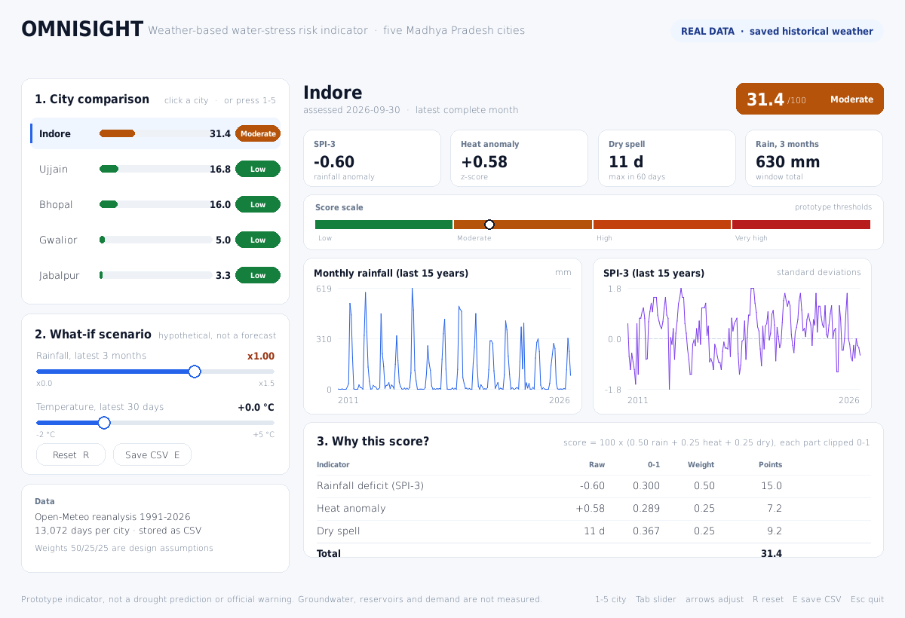

<div align="center">

# OMNISIGHT

**Weather-based water-stress risk indicator for five Madhya Pradesh cities**


[](https://github.com/Mimoboi/omnisight/actions/workflows/tests.yml)

Indore · Bhopal · Gwalior · Jabalpur · Ujjain

[Quickstart](#quickstart) · [How it works](#how-it-works) · [Data](#data) · [Limitations](#limitations)

</div>

> **Prototype, not an operational system.** OMNISIGHT compares three weather
> indicators against a 1991–2020 baseline and reports a transparent 0–100 score.
> It is not a drought prediction, an official warning, or a measurement of actual
> water scarcity. The weights and thresholds are design assumptions and have not
> been calibrated against measured water availability.



---

## Why

Rainfall deficits, unusual heat and long dry spells are early, cheap signals that
can be compared between neighbouring cities. OMNISIGHT puts those three signals in
one window so that a difference between cities is visible, explainable and
reproducible — offline, from cached data.

## Quickstart

```bash
git clone https://github.com/Mimoboi/omnisight.git
cd omnisight
python -m pip install -r requirements.txt
python dashboard.py
```

That is the whole setup: one dependency (`pygame`), no server, no browser, no
build step. The repository already contains the cached weather data, so the
dashboard opens offline straight after cloning.

To refresh the data:

```bash
python fetch_data.py --force     # re-downloads 13,072 days per city
```

**Requirements:** Python 3.11+ and a desktop session. Windows, macOS and Linux.

## Controls

| Input | Action |
| --- | --- |
| Click a city row, or `1`–`5` | Select the city |
| Drag a slider | Apply a hypothetical rainfall / temperature change |
| `Tab`, then arrow keys | Adjust the active slider from the keyboard |
| `R` | Reset to real data |
| `E` | Export `data/omnisight_results.csv` |
| `Esc` / `Q` | Close |

The header banner switches between **REAL DATA** and **SCENARIO**, so a
hypothetical result can never be mistaken for an observation.

### Non-interactive use

```bash
python dashboard.py --city Ujjain --rain 0.7 --temp 2
python dashboard.py --screenshot report.png   # renders one frame and exits
```

`--screenshot` also lets the UI run on machines without a display, which is how
the image above was produced.

## How it works

Three indicators are computed from daily maximum temperature and rainfall, then
combined into a 0–100 score.

| Indicator | Definition |
| --- | --- |
| **SPI-3** | Rainfall over the latest three complete months, ranked against the same ending month in 1991–2020 and converted to standard-normal units. Empirical, not a gamma fit. |
| **Heat anomaly** | Trailing 30-day mean of `tmax`, expressed as a z-score against the same calendar day in 1991–2020. |
| **Dry spell** | Longest run of days below 1 mm in the latest 60 days. |

```text
rain_part = clip(-SPI3 / 2, 0, 1)
heat_part = clip(heat_z / 2, 0, 1)
dry_part  = clip(dry_days / 30, 0, 1)

score = 100 * (0.50 * rain_part + 0.25 * heat_part + 0.25 * dry_part)
```

| Score | Level |
| --- | --- |
| 0 – 25 | Low |
| 25 – 50 | Moderate |
| 50 – 75 | High |
| 75 – 100 | Very high |

Each component and its weighted points are shown in the **Why this score?**
panel, so any number on screen can be traced back to its input. A month is only
scored when it is complete; gaps in the recent window raise an error instead of
silently producing a number.

### Design decisions

- **Empirical SPI.** Ranking against 30 baseline years needs no SciPy and makes no
  distributional assumption. The trade-off is discrete values and a baseline
  standard deviation near 0.90 rather than exactly 1.00.
- **Scenarios never alter history.** A what-if change touches only the latest
  three rain months and the latest 30 temperature days, so a scenario remains
  comparable to the real baseline.
- **View and model are separate.** All numbers come from `risk_engine.py`, which is
  tested independently of pygame.

## Project structure

```text
omnisight/
├── dashboard.py            # pygame window: comparison, charts, sliders, export
├── risk_engine.py          # score, levels, scenarios, monthly history
├── indicators.py           # SPI-3, heat z-score, dry spell
├── fetch_data.py           # Open-Meteo download with retry, cached to CSV
├── requirements.txt        # pygame>=2.5
├── data/                   # cached daily CSVs (1991-01-01 → 2026-10-15)
├── docs/screenshot.png
├── tests/
│   ├── test_indicators.py  # 19 tests, no pygame needed
│   └── test_dashboard.py   # 7 UI tests, auto-skip without pygame or data
└── arctecture.md           # full build blueprint, validation log, judge Q&A
```

## Data

- **Source:** [Open-Meteo Historical Weather API](https://open-meteo.com/en/docs/historical-weather-api)
  (reanalysis-based estimates, not station measurements).
- **Coverage:** daily `temperature_2m_max` and `precipitation_sum`,
  1991-01-01 → 2026-10-15, 13,072 rows per city, zero missing values.
- **Cache:** `data/<city>_daily.csv`, committed so the demo works offline. Delete
  the folder and run `fetch_data.py` to rebuild it.
- **Attribution:** weather data by Open-Meteo. Review the current
  [terms](https://open-meteo.com/en/terms) before public use.

## Testing

```bash
python -m unittest discover -s tests -v
```

26 tests, about 2 seconds. They cover month completeness, rolling windows across
year boundaries, SPI behaviour at the median and extremes, the dry-spell scan,
heat z-scores and the zero-variance guard, level boundaries, the four scenario
invariants, and the UI interactions (selection, slider drag, reset, export, exit).

The UI tests run headless via `SDL_VIDEODRIVER=dummy`, so the suite works on a CI
runner with no display:

```bash
SDL_VIDEODRIVER=dummy python -m unittest discover -s tests
```

## Limitations

- Weather indicators do **not** measure groundwater, reservoir storage, river
  flow, demand, infrastructure or supply.
- The 50/25/25 weights and the 25/50/75 cut-offs are **design assumptions**, not
  calibrated constants.
- Open-Meteo values are reanalysis estimates, not readings from a station in each
  city.
- The 2002 monsoon comparison in the blueprint is *consistent with* the documented
  deficit; the IMD citation still has to be added by the author.
- No predictive accuracy is claimed. Validation is limited to unit tests, a
  baseline sanity check (mean SPI ≈ 0.00) and that 2002 comparison.

## Roadmap

- [ ] Add a validated IMD rainfall comparison with a cited source
- [ ] Add reservoir / groundwater indicators where open data exists
- [ ] Export the evidence report as a PDF
- [ ] Optional map view with offline vector boundaries
- [ ] Sensitivity analysis of the weights

## Contributing

Issues and pull requests are welcome — see [CONTRIBUTING.md](CONTRIBUTING.md).
Please keep the scientific claims conservative: new indicators need a source and
a test.

## License

[MIT](LICENSE). Weather data remains subject to Open-Meteo's terms.

## Acknowledgements

- [Open-Meteo](https://open-meteo.com/) for free historical weather data
- [Copernicus Emergency Management Service](https://drought.emergency.copernicus.eu/)
  for the SPI methodology factsheet
- STEAM Innovation League 2.0, Indore regional round
